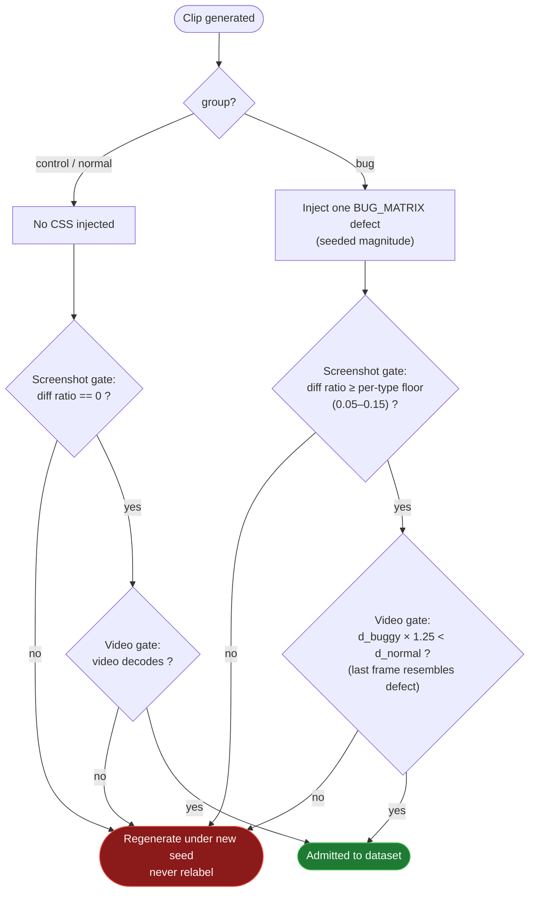

# Dataset Standard — What Counts as Usable Data

This document is the reference definition for how clips are admitted into the
project's datasets (`dataset_v1` → `dataset_v2` → `dataset_v3`). It is written to
be citable in the thesis: every rule below points at the exact source of truth in
the codebase (`file:line`), not at description-after-the-fact.

**Sources of truth**

| Concern | File |
|---|---|
| Bug definitions & injection | [`generator/tests/bug-injection.spec.ts`](../generator/tests/bug-injection.spec.ts) |
| Screenshot quality gate (pixelmatch) | same spec, `pixelDiffRatio()` |
| Video quality gate | [`pipeline/gate_videos.py`](../pipeline/gate_videos.py) |
| Frozen dataset & gate spec (EXP001) | [`experiments/exp001/config.frozen.json`](../experiments/exp001/config.frozen.json) |

---

## 0. Core principle

> A clip enters the dataset **only if it clears both quality gates**. Clips that
> fail are **regenerated under a new seed, never relabelled.**

(`config.frozen.json → quality_gates._role`.)

This is an **injected-ground-truth** dataset. Labels are **not** assigned by human
judgement after the fact — they are *entailed by the injected fault*:

- a **normal** clip has nothing injected, so its label is correct by construction;
- a **buggy** clip has one known CSS defect injected, so its label is the injected
  bug key.

The quality gates therefore do **not** decide the label. Their job is to verify
that the clip *actually exhibits* the state it was assigned — that the labelled
defect is genuinely visible in the artefact the model will consume.

---

## 1. Why these six defect types? (defining the construct)

The construct under study is **"dynamic UI rendering defects."** It is
operationalised as the six entries of `BUG_MATRIX`
([spec:196-283](../generator/tests/bug-injection.spec.ts)). Each corresponds to a
class of real, purely visual/structural rendering failure:

| bug key | injected CSS (mechanism) | real-world failure it stands for |
|---|---|---|
| `skew_distortion` | `transform: skewX + rotate + scale` | geometric distortion (broken transform, RWD collapse) |
| `blur_unreadable` | `filter: blur(10–14px) contrast(1.5)` | filter / GPU-compositing error, content unreadable |
| `vanish_invisible` | `opacity:0 + visibility:hidden` | component disappears entirely (render failure) |
| `flyaway_offset` | negative `margin-top / margin-left` | layout shift, element flies off-screen |
| `flicker_seizure` | two-state `@keyframes` animation | animation judder, repaint loop |
| `displaynone_collapse` | `.main { display:none }` | section removed, content below jumps up |

### 1.1 They span a difficulty spectrum, on purpose

Measured pixel-difference ratios differ by an order of magnitude
([spec:194-195](../generator/tests/bug-injection.spec.ts)):

```
flyaway ~66%   vanish ~55%   flicker ~50%   displaynone ~47%   skew ~28%   blur ~7%
```

**`blur_unreadable` is the hardest class (~7% pixel difference).** Blur preserves
overall layout and colour distribution and only perturbs high-frequency detail. If
the dataset contained only "the whole app is gone" extremes (vanish / flyaway),
a method beating the baseline would prove little — those are trivially detectable.
Blur exists to provide a **lower bound** that is "obvious to a human, but hard for a
machine," so that per-type recall has discriminating power.

### 1.2 Magnitudes are exaggerated *and* randomised *and* reproducible

Using blur as the example — [spec:215](../generator/tests/bug-injection.spec.ts):
`randInt(rng, 10, 14)` draws a blur radius of 10–14px per case.

- **Exaggerated** — a 10px+ blur is unambiguously unreadable, not a marginal 2px.
  This removes label ambiguity: it genuinely *is* a defect, not "a bit fuzzy but
  usable."
- **Randomised** — radius, skew angle, flyaway distance, etc. are drawn from a
  seeded RNG, so the 10 clips of a type are varied samples, not one image ×10.
  This is what makes a per-type sample of 10 statistically meaningful.
- **Reproducible** — `rng_seed = 20260725`; each scenario derives its own seed via
  `RNG_SEED XOR FNV-1a(scenario.id)`. "Random" and "reproducible" hold
  simultaneously, which is the precondition for freezing the experiment.

### 1.3 Injection level is chosen to avoid confounds

Injection points are calibrated so the label actually holds on screen. E.g.
`vanish_invisible` ([spec:226-227](../generator/tests/bug-injection.spec.ts)):
hiding only inner sections leaves the white card intact (~3% diff), so the whole
`.todoapp` card is vanished instead, exposing the grey page background and
producing a large, unambiguous difference.

---

## 2. What "usable" means: the two quality gates

Defined in `config.frozen.json → quality_gates`. The full admission decision — from
a generated clip to "in the dataset" or "regenerate" — is:



Both gates must pass, in sequence. The two branches differ only in what the
screenshot gate demands (exact 0 vs. a per-type floor) and in whether the video gate
has a defect to verify. A failure on either gate sends the clip back to
regeneration — the label is never weakened to fit a marginal clip.

### Gate 1 — Screenshot gate (pixelmatch, at injection time)

Implemented in `pixelDiffRatio()`
([spec:293-315](../generator/tests/bug-injection.spec.ts)). After injecting the
CSS, a `buggy.png` is captured **immediately** and compared pixel-by-pixel against
the pre-injection `normal.png`; the output is a **difference ratio `diffRatio`.**

Two requirements, in opposite directions:

**(a) Buggy clip — difference must be large enough.** Each bug type has its own
`minDiffRatio` floor ([spec:184](../generator/tests/bug-injection.spec.ts);
collected in `min_diff_ratio_by_bug_type`):

| bug type | minDiffRatio |
|---|---|
| `blur_unreadable` | **0.05** |
| `skew_distortion` | 0.10 |
| `displaynone_collapse` | 0.12 |
| `vanish_invisible` | 0.15 |
| `flyaway_offset` | 0.15 |
| `flicker_seizure` | 0.15 |

Below the floor → `case rejected`
([spec:545-546](../generator/tests/bug-injection.spec.ts)). The thresholds are
**per-type on purpose**: blur's floor (5%) is far below flyaway's (15%) because
blur's intrinsic difference is small. The floor is a per-type lower bound on "how
visible must this type at least be," not a single cutoff.

**(b) Control clip — difference must be exactly 0.**
(`control_requirement: "diff ratio must be exactly 0"`.) To make a true 0% possible,
`stabilizeForScreenshot()`
([spec:321-327](../generator/tests/bug-injection.spec.ts)) blurs focus and moves
the cursor off-screen, removing non-deterministic pixels (blinking caret, hover,
focus ring). The pixelmatch `threshold: 0.03`
([spec:307-311](../generator/tests/bug-injection.spec.ts)) is itself calibrated for
TodoMVC's low-contrast palette (white `#fff` card on a `#f5f5f5` page).

> **Why this gate is not sufficient:** it never decodes the video. It compares two
> *screenshots*, but the artefact fed to the model is the *video*.

### Gate 2 — Video gate (the check `dataset_v1` was missing)

Implemented in [`pipeline/gate_videos.py`](../pipeline/gate_videos.py). Requirement
(`video_gate.requirement`):

> The **final decoded video frame** must resemble `buggy.png` rather than
> `normal.png`.

Logic at [gate_videos.py:128-134](../pipeline/gate_videos.py): decode the last frame →
crop to the app's clip region → compute its difference against both `normal` and
`buggy` references → decide:

```python
passed = d_buggy * DECISION_MARGIN < d_normal   # DECISION_MARGIN = 1.25
```

I.e. the last frame must be at least **1.25× closer** to the buggy reference than
to the normal one. "Closer to" (rather than "exactly equal to buggy") is used
because the user keeps typing after `buggy.png` is captured, so the last frame is
never byte-identical to it ([gate_videos.py:131-133](../pipeline/gate_videos.py)). The
1.25 margin prevents passing on noise.

Control clips have nothing injected, so there is no defect to verify — they pass as
long as the video decodes ([gate_videos.py:112-114](../pipeline/gate_videos.py)).

**dataset_v3 result: 120/120 pass.** The 60 buggy clips' last-frame difference vs
normal ranges 0.1091–0.6927, vs buggy ≈ 0.

---

## 3. Three invisible admissibility standards (no label leakage)

Beyond "is the defect visible," a usable clip must not **leak its label through any
side channel**. These controls protect the experiment's **internal validity**.

| # | Leakage risk | Control |
|---|---|---|
| A | **Duration leaks the label.** A static bug (app gone) emits ~1 frame; a dynamic bug (flicker) emits continuously — so clip length correlates with the label. | Fixed **7000ms** post-injection hold (`DEFECT_HOLD_MS`), identical for both groups, plus a screencast heartbeat that forces static states to keep emitting frames. ([spec ~433](../generator/tests/bug-injection.spec.ts)) |
| B | **On-screen text leaks the label.** `dataset_v1` typed the scenario id — *including the bug name* — into the input box; any model reading the screen saw the answer. | Post-injection typing uses neutral todo phrases. (Fixed in v2, recorded in `config._why_not_v2`.) |
| C | **DOM trace leaks the label.** Path B records DOM mutations as a structural signal; the injection itself could show up in the trace. | The MutationObserver observes **`document.body` only**; the malicious stylesheet is appended to `<head>`, so the injection is structurally invisible to the trace — only legitimate user-driven DOM activity remains. ([spec:350-357](../generator/tests/bug-injection.spec.ts)) |

---

## 4. Version lineage (v1 → v2 → v3)

From `config.frozen.json → provenance_of_generator`:

- **v1** had two fatal defects: (a) Playwright's recorder lost the single defect
  frame of static broken states, corrupting every `flyaway_offset` clip and 3/5
  `vanish_invisible` clips; (b) post-injection typing wrote the bug name onto the
  screen, leaking the label.
- **v2** fixed both and introduced the **video gate** that would have caught (a).
- **v3** reuses the *fixed* v2 generator unchanged and only scales the case counts.

### Balance: what changed from the PoC

From `dataset → balancing_strategy._change_from_poc`:

- **PoC (n=16)** deliberately oversampled the two lowest-diff types (blur, skew ×2),
  because n=16 could not carry every type.
- **v3 (n=120)** uses **stratified equal allocation — 10 clips per type**. This makes
  (1) per-type recall a reportable number, and (2) aggregate anomaly recall no longer
  skewed toward the hard types.

### dataset_v3 at a glance

| property | value |
|---|---|
| total clips | 120 (60 normal / 60 anomalous) |
| bug types | 6, 10 clips each |
| subject app | TodoMVC (React), single implementation by design |
| viewport / browser | 1280×720, chromium |
| post-injection hold | 7000ms, both groups |
| RNG seed | 20260725 (120 distinct per-scenario seeds) |
| screenshot gate | pass (per-type floors 0.05–0.15; controls exactly 0) |
| video gate | 120/120 pass |

---

## 5. One-paragraph definition for the thesis

> A clip is admitted to dataset_v3 iff it satisfies a two-stage automated quality
> gate. **Stage 1 (screenshot gate)** requires that a pixelmatch comparison between
> the pre- and post-injection screenshots yields a difference ratio ≥ a
> per-defect-type threshold (0.05–0.15, calibrated to each defect's intrinsic visual
> magnitude) for anomalous clips, and exactly 0 for control clips. **Stage 2 (video
> gate)** requires that the final decoded video frame is at least 1.25× closer to the
> injected (defective) reference than to the clean reference, guaranteeing the
> labelled defect is present in the temporal artefact actually consumed by the model,
> not merely in a screenshot. Clips failing either gate are regenerated under a new
> seed, never relabelled. Labels are not assigned by human judgement but are entailed
> by the injected fault, and three leakage controls (fixed post-injection duration,
> neutral on-screen text, head-scoped DOM tracing) ensure the label cannot be inferred
> from any channel other than the rendered defect itself.

---

## 6. How to re-run the gates

Screenshot gate runs during generation (Playwright test). To (re)run the video gate
against a dataset directory, from the repo root:

```bash
python3 pipeline/gate_videos.py dataset_v3
```

Report-only; writes `dataset_v3/video-gate-report.json`. Add `--prune` to also delete
failing cases and rewrite metadata (v3 currently passes 120/120, so prune is a no-op).
